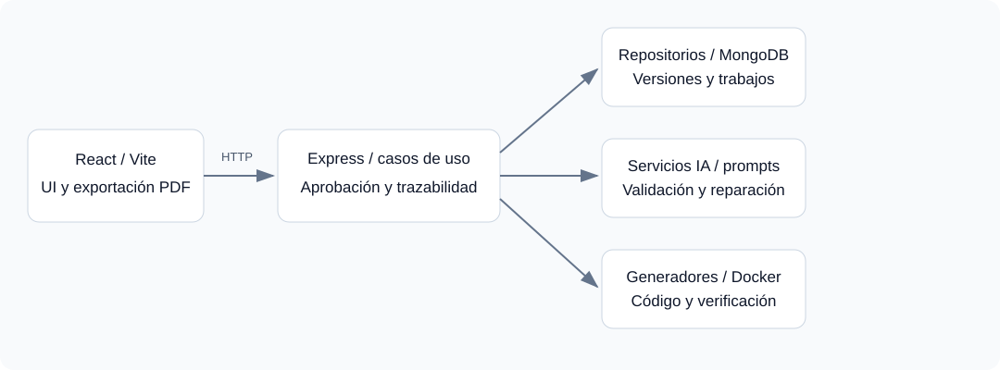

# Arquitectura de la herramienta

I-CASE usa React/Vite en el navegador y un backend Express/Node.js con persistencia MongoDB/Mongoose. El backend organiza entidades y casos de uso, adaptadores y servicios de infraestructura.

## Estructura del repositorio

| Directorio | Responsabilidad |
| --- | --- |
| icase-frontend/src/components | Espacios de proyecto, requisitos, diagramas, mockups, documento y plan de código |
| icase-frontend/src/services | Cliente HTTP y exportación/renderizado según servicio |
| icase-backend/src/core/entities | Modelo de dominio de I-CASE |
| icase-backend/src/core/use-cases | Reglas de operaciones, aprobación e invalidación |
| icase-backend/src/core/services | Flujo, semántica y controles de artefactos |
| icase-backend/src/interface-adapters | Controladores HTTP y repositorios Mongo |
| icase-backend/src/infrastructure | Esquemas, proveedores, prompts, validadores y generadores |
| icase-backend/src/routes | Registro de endpoints Express |
| icase-backend/tests | Pruebas unitarias y escenarios de flujo |
| docs | Manuales, contrato API, prompts y evidencias |

## Datos principales

- Usuario: identidad, correo y hash de contraseña.
- Proyecto: información inicial, relación de usuario y estado de fase.
- Fuente: proyecto, archivo, extracción/transcripción y metadatos.
- Requerimiento: proyecto, RF/RNF, evidencia, origen y aprobación.
- Diagrama: tipo, código, calidad, historial y versiones de origen.
- Diseño: catálogo de pantallas, mockups, trazabilidad y sistema visual.
- TrabajoGeneracion: proyecto, tipo, progreso, estado y lease operativo.
- PlanCodificacion: propuestas, decisiones, etapas y versiones.
- ArtefactoGenerado: archivos con huellas, dependencias, aprobación y verificación.

Consulta los esquemas en `src/infrastructure/database/schemas/` para restricciones exactas. Los IDs API se serializan habitualmente como cadenas `id`; no debe suponerse que todos los objetos comparten exactamente el mismo formato.

## Flujo y trazabilidad

La generación se apoya en dependencias aprobadas. Casos de uso preceden a dominio; ambos alimentan software; sistema depende de software; diseño técnico y navegación consumen sus dependencias específicas.

Cambiar la especificación invalida artefactos dependientes. La restauración de contenido no debe saltarse la revisión. La calidad y la aprobación son dimensiones diferentes: un resultado válido sintácticamente sigue pendiente de aceptación humana.

La verificación del código usa hashes para ligar evidencia a archivos exactos. Modificar contenido invalida ese vínculo. Infraestructura y pipeline tienen revisión estructural; backend/frontend/pruebas/paquete requieren ejecución según su etapa.

## Servicios y separación

`ProcesarConIA` orquesta análisis y diagramas. `GenerarMockups` reúne pantallas y contexto. `AprobarFase` y los servicios de flujo aplican dependencias. `GestionarPlanCodificacion` administra decisiones y `GestionarArtefactosCodigo` produce y revisa entregables.

La base CRUD actual usa operaciones identificadas por RF. No es todavía una traducción semántica completa de las clases de dominio. Los generadores deterministas y el verificador usan un conjunto de stacks soportados, no un compilador universal.

Los trabajos de diagramas/mockups se persisten y consultan por polling; la verificación Docker actual no posee por ese hecho la misma recuperación persistente.

## Restricciones actuales

La URL del backend está fija en el cliente. CORS es amplio y varios routers no exigen autenticación; los permisos por propiedad requieren endurecimiento. Las rutas largas de verificación pueden encontrar límites de proxy. Los recursos de diagrama o Swagger pueden depender de servicios externos. No debe anunciarse producción segura o multitenencia aislada sin completar esas tareas.

Los contratos existentes se mantienen en [Diagramas](contratos/diagram-generation-contract.md) y [Codificación](contratos/code-generation-contract.md).
