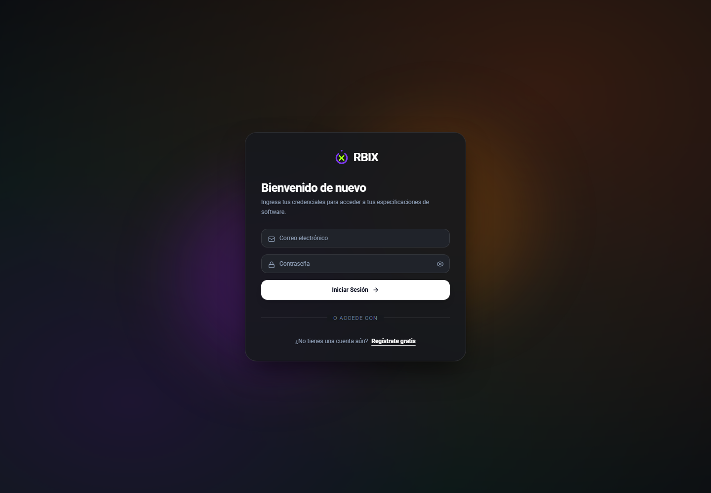

# Primeros pasos

## Propósito y personas usuarias

I-CASE ayuda a organizar la información de un proyecto, analizarla y revisar los artefactos antes de avanzar. La persona usuaria registra fuentes, revisa propuestas y decide qué aprobar. La persona responsable de la instalación configura servicios y credenciales.

No existe aquí un catálogo implementado de roles «mesero», «cajero» o «cliente»: esos actores pertenecen a los proyectos generados, no a los permisos de I-CASE. Tampoco debe asumirse un panel de administración de roles que el producto no expone.

## Acceso

Captura del 20/10/2026, Edge headless, 1440 × 1000, perfil temporal sin sesión. La interfaz muestra la marca RBIX; esta documentación conserva I-CASE como nombre del proyecto académico.

1. Solicita al responsable la dirección de la aplicación; en desarrollo suele ser `http://localhost:5173`.
2. Selecciona registro e ingresa nombre, apellido, correo, celular y contraseña.
3. La contraseña de registro requiere actualmente al menos seis caracteres; utiliza una más robusta.
4. Inicia sesión con correo y contraseña.
5. Si aparece «Token inválido o expirado», vuelve a iniciar sesión. Conserva el proyecto y evita reprocesar las fuentes para resolver un error de acceso.

La sesión usa un token guardado por el navegador. Evita equipos compartidos y cierra sesión al terminar.

## Crear y abrir un proyecto

Desde el listado crea un proyecto y asigna un nombre identificable. Abre su espacio de trabajo para añadir la información inicial. Cada proyecto debe contener únicamente fuentes relacionadas con su propio alcance.

Puedes reabrir un proyecto existente para consultar sus artefactos. Usa el proyecto correcto antes de cargar archivos; no mezcles versiones de entrevistas ni requisitos de negocios diferentes sin explicarlo.

## Cargar y contextualizar las fuentes

1. Selecciona **Subir Insumos**.
2. Elige un texto, PDF o grabación compatible. El límite del receptor es 50 MB por archivo.
3. Espera la extracción o transcripción.
4. Revisa el contenido obtenido y corrige nombres, cantidades y frases mal interpretadas.
5. Completa título, descripción, tipo/categoría y etiquetas cuando corresponda. Puedes solicitar una sugerencia de metadatos y revisarla antes de guardarla.
6. Comprueba que se incluyó lo que se debe analizar.

Un PDF escaneado puede carecer de texto extraíble. En ese caso suministra una transcripción revisada; no presupongas que cualquier escaneo tendrá OCR correcto. En audio, evita ruido y voces superpuestas.

Un archivo con el mismo nombre dentro del proyecto puede actualizar la fuente existente. Utiliza nombres claros si deseas conservar entrevistas diferentes.

## Preparar una buena entrada

Incluye problema, usuarios, tareas, datos, reglas y límites. Separa decisiones confirmadas de ideas propuestas.

Ejemplo: «El bibliotecario registra préstamos y devoluciones. Un ejemplar no puede tener dos préstamos activos. React y PostgreSQL están confirmados. La alta disponibilidad queda fuera del alcance. El tiempo máximo de respuesta todavía no fue acordado».

No proporciones cifras de latencia o concurrencia que no se hayan acordado. Si solo se solicita seguridad de forma general, explica qué operaciones requieren cuenta o permisos y deja pendientes las métricas no definidas.

## Proveedor y transición a diseño

El selector de proveedor permite escoger entre opciones disponibles en la instalación. El modo automático puede utilizar un proveedor alternativo; el resultado depende de credenciales, cuotas y disponibilidad.

Después de aprobar requisitos, el sidebar muestra los requisitos como referencia de lectura en las fases posteriores. Las modificaciones de fuentes o requisitos deben tratarse como cambios del alcance y pueden invalidar artefactos descendientes.

Continúa con [Requisitos y diagramas](requisitos-y-diagramas.md).
